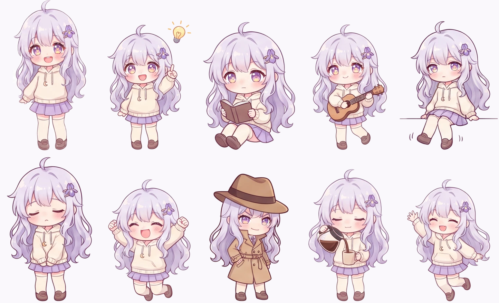

# Making Iris's art

Iris's code is in this repository. Her drawings are not: the original art stays with the person it was made for.
This page is how it was made, so you can make a set of your own, as Iris or as a character of your own.

## What the app reads

Everything goes under `app/Resources/`. `build.sh` copies whichever of these folders exist into the app.

| Path | What | Size |
|---|---|---|
| `sprites/master.png` | Her portrait: standing, facing you, transparent background | 289 × 440 |
| `live/<pose>/` | Her rig for an everyday pose (`stand`, `sit`, `sleep`, `wave`, `laptop`): one picture that bends, plus overlay layers | see below |
| `anim/<id>/0.webp … 15.webp` | A drawn animation: 4–16 frames, played in order (PNG works too) | 289 × 440 each |
| `catalog.json` | Every animation: `id`, `category`, `shows` (what the frames show), `when` (when it fits), and `"rig": "yes"` for moves the rig plays without frames | in the repo |

The catalog is already here. An `anim/<id>` folder that doesn't exist is simply never played, so you can start with a
handful of animations and add more later.

**Frame rules.** All frames are 289 × 440 with a transparent background. She stands on the same baseline in every frame
(her feet at y = 435 from the top). Her head is the same size as in `master.png`, so changing animations doesn't change
her size.

## 1. Her master picture

Every other picture is drawn from this one, so it's worth redrawing until it's right. We used an image model that
accepts reference pictures (Gemini 3 Pro Image, through OpenRouter; about $0.13–0.24 a picture at 4K). Any model that
can keep a character consistent from a reference will do.

The prompt Iris came from:

> Create an original chibi anime character illustration named Iris, in a soft, painterly kawaii style like
> high-quality chibi stickers: gentle cel shading with soft gradients, delicate clean line art, warm pastel colors,
> rosy blushing cheeks.
>
> Character: a cute chibi girl, head about half of her total height. Huge glossy eyes with layered highlights and
> sparkles, warm amber-violet irises. Long, soft, wavy lavender-silver hair with airy bangs and a small ahoge, and a
> little purple iris-flower hair clip. She wears an oversized cream knit hoodie with sleeves covering her hands, a small
> crescent-moon charm on the hoodie string, a short pleated lavender skirt, cream knee socks and soft brown shoes.
>
> Pose: full body, standing, facing the viewer, relaxed and friendly with a small sweet smile, hands together in front.
>
> Composition: the whole character centered, fully in frame with margin around her, on a perfectly plain flat pure
> white background. No ground shadow, no props, no text, no border, no background decoration.

The plain white background is what lets step 3 cut her out cleanly.

## 2. Animation sheets

Each animation is drawn as one sprite sheet, with the master picture attached as the reference. The prompt pattern:

> This is Iris, an original chibi character (reference image attached). Create a high-quality animation sprite sheet
> of the exact same character: identical face, hair, iris-flower hair clip, outfit, colors, proportions, clean line
> art and soft painterly anime style.
>
> The sheet: ONE horizontal row of 8 frames, evenly spaced, each frame the same size, the character the same scale in
> every frame with her feet (or seat) on the same baseline, the whole character fully visible head to toe in every
> frame with white margin around her. Consecutive frames must change only a little so the loop plays smoothly.
> Frames 1–8: **WAVING loop, standing facing the viewer, right arm raised waving the sleeve-covered hand side to side…**
>
> Plain flat pure white background, no shadows, no text, no frame borders.

Only the bold part changes per animation. The `shows` text in `catalog.json` is a good starting point for it. To save
money, put four animations on one 4K sheet, one per row, and say so in the prompt.

Check each sheet before cutting it: every frame complete, the same character, the same scale. Redraw any sheet that
isn't. A bad frame looks much worse moving than it does still.

## 3. Cutting frames

From each sheet:

1. **Lift the background.** Treat near-white pixels connected to the edge of the sheet as background, and make them
   transparent. Don't clear white areas enclosed by her outline (eye whites, socks). Un-blend edge pixels from white,
   so her outline doesn't keep a pale fringe.
2. **Find the frames.** Rows come from the empty bands between them. Within a row, the frame spacing comes from how
   her drawing repeats along it. Keep only the figure centred in each cell, plus props touching her.
3. **Size and place.** Scale each animation so her head matches the master picture's. Put her on a 289 × 440
   transparent canvas with her feet on the baseline, centred.
4. **Clean up.** Remove small specks that don't touch her, then save as `anim/<id>/0.webp`, `1.webp`, …

Pillow and NumPy are enough for all of it.

## 4. Her rig (optional, and what makes her feel alive)

Her everyday poses aren't frames. Each one is a single picture that the app bends on a mesh (head tilt, turning,
nodding, breathing, hair that sways), with a few layers drawn over it. Each `live/<pose>/` folder holds:

| File | What |
|---|---|
| `base.png` | The pose, cut out like a frame but at full resolution (the standing one is 434 × 660) |
| `lid3.png` | Her eyes closed, for blinking |
| `happy.png` | Happy closed eyes (^ ^) |
| `blush.png` | A deeper blush |
| `m_a.png`, `m_o.png`, `m_e.png`, `m_i.png` | Mouth shapes for speech |
| `m_laugh.png`, `m_smile_open.png`, `m_grin.png`, `m_pout.png`, `m_frown.png`, `m_flat.png`, `m_cat.png`, `m_wobble.png` | Mouth shapes for feelings |
| `live.json` | Where her parts are, as fractions of the canvas measured from the bottom left: `size` [w, h] in pixels, `neck`, `face`, `mouth`, `eyes` {`l`, `r`}, `feet`, `hem`, `legs`, `leg_gap`, `shoulders` |

Every layer is a full canvas the same size as `base.png`, so the same mesh bends them all and nothing drifts. Draw a
layer over the base and inpaint the skin under it from the surrounding picture, rather than drawing a new face. That
way her face stays exactly as painted. `Live.swift` shows how each layer is used.

A pose with no `live/<pose>/` folder isn't rigged. The app skips it and keeps showing `master.png` (see the rig setup
in `SpriteView.swift`).

## Before you share your art

The art is yours to license as you like. This repository's MIT license covers the code only. If you base a character
on Iris's prompt, change enough that it's yours.
